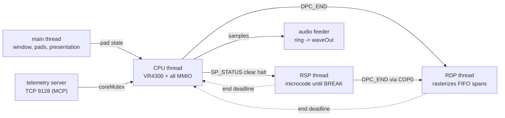

# kestrel64 — Architecture

Synced with: 30d291b

This is the top-level map of the emulator: what each part does, how the parts talk, and which
invariants hold them together. It sits one level above the design documents; each section ends
with the documents to read for depth. The Spanish version, `docs/ARQUITECTURA.md`, has the same
sections in the same order. Both files are updated in the same commit, and
`scripts/check_docs_sync.py` fails if their structure or `Synced with:` line diverge.

Current figures and per-subsystem status live in `docs/STATUS.md`; open gaps in `docs/GAPS.md`.

## 1. Overview

kestrel64 is a low-level (LLE) Nintendo 64 emulator written from scratch in C++20 (clang,
Windows, statically linked). There is no high-level emulation: no libultra function is
intercepted, and the RSP runs microcode instruction by instruction. Everything goes through the
real MMIO registers (`SP_*`, `DPC_*`, `VI_*`, `AI_*`, `SI_*`, `PI_*`, `MI_*`) and MI interrupts.

The architectural bet is **real OS threads** for the CPU, the RSP and the RDP, instead of the
cooperative single-thread scheduling (cothreads) that cycle-accurate emulators use. The target
is a host with weak single-thread performance and idle cores or GPU, where a cooperative design
hits a ceiling of one core.

Threads in the process:

The RSP and RDP threads exist only in Threaded mode; in Lockstep mode the CPU thread does all
three jobs (section 2). Determinism is a design requirement, not an accident: Lockstep is
deterministic by construction, and Threaded must produce the same final state (statehash) when
the host-side shortcuts are off.

Depth: `docs/ARCH-COMM.md` (execution model, written for external review),
`docs/ARCH-THREADING.md`, `docs/STATUS.md`.

## 2. Time model

All guest time is counted in **retired guest instructions** ("ops"); there is no separate
master cycle counter. A CPI model (default 1.4, `KESTREL_CPI`) converts ops into CPU cycles, and
`rcpOpsToCycles` / `rcpCyclesToOps` convert to the 62.5 MHz RCP clock. The clock every component
reads is `Memory::cartNow()`: retired ops plus ops of the JIT chain in flight plus cache stalls
when the physical cost model is on. The VI field length, VI interrupts and `VI_V_CURRENT` all
derive from the same clock (`docs/VI-CLOCK.md`).

Scheduling has two mechanisms:

- **Deadlines on the guest clock**, checked by the CPU thread after every instruction and after
  every JIT block: VI, AI, SI and PI completion, and the end of RSP and RDP work. A DMA has a
  duration; its effect and its interrupt happen when the deadline is reached. The JIT may not
  swallow a deadline inside a block (`rcpDueIn`).
- **Rendezvous between threads** in Threaded mode. The RSP and RDP are not scheduled by time;
  they are coupled to the CPU clock at the points where hardware forces one to see what the
  other did (SP barrier, read syncs, write barriers, logs, RSP parking on FIFO waits).

The hard rule: **only the CPU thread changes guest-visible state at a given instant.** The
workers compute and propose (they arm deadlines stamped in guest time); the CPU thread publishes
when its clock reaches that instant. Cross-thread data goes through release/acquire atomics or
the `rspMx`/`rdpMx` mutexes.

The two modes:

| | Lockstep | Threaded (`KESTREL_THREADS`, default) |
|---|---|---|
| RSP | interleaved inside the CPU loop, 4/3 RSP ops per CPU op | own thread, coupled by rendezvous |
| RDP | synchronous inside the `DPC_END` store | SPSC queue + worker |
| Use | deterministic reference, systemtest | playing and measuring |

Two host shortcuts let the CPU run ahead of the RSP for speed: `KESTREL_SPLEAD` (auto = 512) and
`KESTREL_DPLOGLEAD`. They are on in free-running play, and forced to 0 in "faithful to console"
speed mode (`KESTREL_SPEEDMODE=hw`) and in every gate. With both at 0, Threaded gives the same
statehash as Lockstep; that equality is the invariant the gates check.

Depth: `docs/ARCH-COMM.md` (sections 2-3, 6-8), `docs/ARCH-SYNC.md`, `docs/HW-RCP-COMM.md`,
`docs/PERF-RCP-SYNC.md`, `docs/history/SUBSCHED-2026-09.md` (submit-time RDP scheduling and RSP
parking).

## 3. Memory and bus

The `Memory` class (`src/core/memory.hpp`) owns RDRAM (8 MB, or 4 MB with `KESTREL_RDRAM=4`), every MMIO register,
the DMA engines and the inter-thread rendezvous. The CPU thread owns all MMIO; the only other
writer of RCP registers is the RSP through its COP0.

- **DMA**: PI (cartridge, with transfer cost and I/O latch decay), SI (PIF/joybus, which runs
  inside the PIF-to-RDRAM read DMA, as on hardware), SP (DMEM/IMEM against RDRAM) and AI. SI and
  PI transfers have a duration and complete on a deadline.
- **Caches and TLB** live in the CPU (section 4): the I- and D-caches are modelled with tags and
  dirty lines, and a CPU write is visible to the RSP only when it actually reaches RDRAM (dirty
  line write-back or uncached store), which is where `cpuRamWrBarrier` sits.
- **MI**: `mi_intr` is an atomic; producers publish with release after their RDRAM writes, the
  CPU acquires when it reads.
- **PIF, saves and cartridge hardware**: PIF boot with real IPL2 checksum and CIC detected by
  signature; EEPROM, SRAM, FlashRAM; four controllers with Rumble, Controller and Transfer Pak;
  SummerCart64 with a virtual FAT32 SD card.

Its implementation is split by responsibility (map in `src/core/memory_internal.hpp`):
`memory.cpp` (reset, address map, CPU reads/writes, PI bus), `memory_cart.cpp` (saves, paks,
SummerCart64), `memory_mmio.cpp` (register file, VI/AI ticks), `memory_dma.cpp` (PI/SP/SI DMA),
`memory_pif.cpp` (PIF, CIC, RTC, joybus), `rcp_rdp.cpp` (RDP jobs and worker) and
`rcp_sync.cpp` (pacing, guest-time barriers, rendezvous, RSP worker).

Depth: `docs/ARCH-COMM.md` (section 4), `docs/FLASHCART-SD.md`, `docs/ROMS-COMPRIMIDAS.md`.

## 4. CPU

- **Interpreter** (`src/cpu/cpu*.cpp`): 64-bit MIPS III with delay slots, full COP0, FPU with
  rounding and flags, 32-entry TLB with its exceptions, I- and D-caches modelled with tags, and
  the Watch exception. It is the reference: the dynarec calls its helpers for the hard cases.
- **Dynarec** (`src/cpu/jit*.cpp`: code cache and linking in `jit.cpp`, emitters and
  `compileBlock` in `jit_compile.cpp`, CPU-side dispatch in `jit_run.cpp`; on by default, `KESTREL_JIT=0` turns it off): straight-line
  blocks compiled from a physical address to x86-64, with register residency in Win64
  non-volatile registers, fast memory with guards, static block linking, an indirect target cache
  for `JR`/`JALR`, page-crossing blocks, COP0 inside blocks, and self-modifying code detection
  per I-cache line. Operations it does not emit natively (most FPU, unaligned loads and stores,
  64-bit multiply/divide) call into the interpreter without breaking the block. "Level 2" of the
  dynarec plan closed on 2026-10-01.
- **Cycle model**: flat CPI 1.4 by default; an optional physical model (`phys` gate modes) adds
  I/D-cache miss, uncached access, MULT/DIV and FPU latency and interlock costs.
- **PGO**: the release build uses a committed profile (`pgo/kestrel.profdata`). It only changes
  host code layout; the guest statehash is identical with and without it.

Depth: `docs/CORES-CPU-RSP.md` (sections 2-3), `docs/PERF-CPU.md`, `docs/JIT-PLAN.md` (original
plan, partly historical).

## 5. RSP

- **Interpreter** (`src/rsp/rsp.cpp`): scalar core plus the vector unit (8 lanes of 16 bits,
  48-bit accumulator, flags and saturation) implemented with SSE4.1.
- **RSP JIT** (`src/rsp/rspjit.cpp`, on by default, `KESTREL_RSPJIT=0` turns it off):
  straight-line blocks, absorbed branches, COP0 in blocks and linking through a 1024-slot direct
  table; parts of COP2 are emitted inline. The framebuffer md5 is the same with the JIT on and
  off in every gate mode.
- **Pipeline timing model** (`KESTREL_RSP_TIMING=1`, `src/rsp/rsptiming.hpp`): counts stalls and
  dual-issue per IMEM slot for profiling. It forces the interpreter and does not move the guest
  clock.
- Task start is stamped by the CPU thread on the `SP_STATUS` clear-halt write; task end is a
  deadline published by the CPU thread (`BROKE` + `MI_SP`).

There is no graphics microcode HLE, by design.

Depth: `docs/CORES-CPU-RSP.md` (sections 4-5), `docs/RSP-JIT.md`.

## 6. RDP

A `DPC_END` write (from the CPU or the RSP) files a FIFO span; the RDP thread rasterizes it.
The span's guest timeline (start, end, `DPC_CURRENT` boundaries, `MI_DP` deadline) is computed at
submit time from the RDP cost model, so the worker only paints. Reads of `DPC_CURRENT` and
`DPC_STATUS` are answered on the clock of whoever reads.

Three rasterizers share that front end:

- **SoftRDP** (`src/rdp/rdp.cpp`): the bit-exact reference, on the CPU. LOD and mipmaps,
  perspective correction, integer interpolation, delta-z, TMEM odd-row swap and coverage
  antialiasing. It is what `gate_all.sh` runs, so the deterministic oracle never depends on a
  GPU.
- **GPU-RDP** (`src/gpurdp/`, Vulkan compute, default since 2026-10-06): bit-exact with SoftRDP
  at native resolution. The CPU/GPU split per span is by size (`KESTREL_GPURDP_MINPX`). Internal
  upscaling x2, x4 and x8 runs in **shadow mode**: SoftRDP paints at 1x and stays the authority
  on RDRAM, while the GPU produces the high-resolution copy asynchronously; writes that reach the
  images by other paths are found by diffing the mirror and patched in.
- **parallel-RDP**: removed. Off the menus and gates on 2026-10-30, code deleted on 2026-11-02.
  `KESTREL_PRDP=0` still selects SoftRDP; `KESTREL_PRDP=1` now means GPU-RDP (and warns). The
  presenter and GPU-RDP share one Vulkan context (`gpurdp::sharedVk()` + `gpurdp::queueLock`).

HD texture packs (Rice/GLideN64 format) work in SoftRDP and GPU-RDP (`src/rdp/texpack.cpp`).

Depth: `docs/GPU-RDP.md`, `docs/RDP-TIMING.md`, `docs/RDP-COVERAGE-AA.md`,
`docs/RDP-FIFO-BACKPRESSURE.md`, `docs/TEXTURE-FORMATS.md`, `docs/TEXTURAS-HD.md`,
`docs/FIDELITY.md`.

## 7. VI, presentation and audio

- **VI**: no framebuffer of its own; each field it rereads RDRAM. Interrupts fire on half-line
  crossings of `VI_INTR`, from the same clock as `VI_V_CURRENT`.
- **Presentation** (`src/video/present.cpp`): GLFW window with Vulkan, or GDI when there is no
  Vulkan. The VI filter (antialias, dedither, divot) is applied in the presenter
  (`vifilter.cpp`), followed by optional image filters (`postfx.cpp`, `KESTREL_FILTER`), aspect
  ratio and SSAA. Screenshots and video capture in guest time (`capture.cpp`).
- **Audio** (`src/audio/audio.cpp`): the AI DAC drains per sample in integer arithmetic on the
  guest clock, with the sample clock of the TV standard (NTSC, PAL, MPAL). A host feeder thread
  only consumes a ring into waveOut; it never touches guest time.

Depth: `docs/VI-CLOCK.md`, `docs/FILTROS-IMAGEN.md`, `docs/ESCALADO-Y-ASPECTO.md`.

## 8. State: savestates, rewind and TAS

- **Savestates** (`src/core/savestate.cpp`, format v22, loads v14-v21) are taken only at a
  natural rest of the RCP (`System::quiesceRcp`: engine drained, task finished), so derived
  schedules are not serialised; they are reset on load.
- **Rewind** (`src/core/rewind.cpp`) keeps periodic snapshots; off by default.
- **TAS** input movies in `.k64m` format (`src/core/movie.hpp`), recorded and played back per
  controller read, with frame advance from the window or the MCP.

Depth: `docs/SAVESTATES.md`, `docs/REWIND.md`, `docs/TAS.md`.

## 9. Telemetry, MCP and debugger

- **Telemetry server** (`src/telemetry/server.cpp`) on TCP port 9128: length-framed JSON plus raw
  binary payloads (RAM dumps and framebuffers travel as bytes). It takes `coreMutex` to act on
  the core. The MCP bridge `tools/mcp/kestrel_mcp.py` exposes it to agents: run control,
  memory, registers, disassembly, breakpoints, controller injection, framebuffer capture,
  profilers, guest symbols and netplay.
- **Debugger** (`src/debug/dbg.cpp`, `src/telemetry/server_dbg.cpp`, ImGui window with
  `--debugger`): RDP/RSP frame recorder, timeline, TMEM and TLB viewers, event log, memory
  watch, SummerCart64 USB log, hot reload of code, RSP microcode and ROM, and RSP breakpoints.
  The window talks to the same server as the MCP.
- **Host profiler** (`src/telemetry/hostprof.cpp`): samples host threads to show where wall time
  goes.

Depth: `docs/MCP-GUIA.md`, `docs/DEBUGGER.md`, `docs/ENV-VARS.md`.

## 10. Build, packaging and verification

- Toolchain: clang from MSYS2 CLANG64, CMake + Ninja. Every tree links statically; only the
  system `vulkan-1.dll` is imported, and `cmake/check_static.cmake` fails the build otherwise.
- `sh scripts/release.sh` rebuilds the four trees, the frozen launcher, the portable zip and the
  installer, and writes `dist/VERSION.txt`. The package ships one `kestrel64.exe` with GPU-RDP and
  SoftRDP.

Verification is by oracles, not by eye:

| Gate | What it covers |
|---|---|
| `scripts/validate.py systemtest` | n64-systemtest: 0/3721 failures, Timing 0/2, Cycle 0/6 |
| `scripts/validate.py sm64` | framebuffer md5 after N buffer swaps, equal in every mode |
| `scripts/validate.py krom` | 371 RDP accuracy ROMs against a baseline |
| `scripts/gate_all.sh` | all the above in every CPU/RSP mode on SoftRDP, plus unit tests |
| `scripts/gate_gpurdp.sh` | the same material on GPU-RDP |
| `scripts/gate_quick.sh` | quick per-change subset (~1.5 min) |
| statehash, Threaded vs Lockstep | determinism with `SPLEAD=0` and `DPLOGLEAD=0` |
| `test/*.cpp` | unit tests that need no ROM (also run in CI) |

Speed is measured with `scripts/validate.py bench` (wall time for a fixed number of guest VI
fields), never with MIPS: in Threaded mode a faster CPU thread can burn more spin-wait
instructions while the emulator gets slower. The gates need ROMs that are not in the repository;
CI (`.github/workflows/build.yml`) checks that the tree builds and runs the unit tests.

Depth: `docs/distribucion.md`, `CONTRIBUTING.md`, `docs/baselines/`.

## 11. Source map

| Directory | Responsibility | Entry files |
|---|---|---|
| `src/main.cpp` | command line, startup | `main.cpp` |
| `src/core/` | run loop and clocks, memory/MMIO/DMA/rendezvous, ROM loading, saves, savestates, rewind, cheats, archives, cartridge extras | `system.cpp`, `memory.cpp` (+ `memory_*.cpp`, `rcp_*.cpp`), `rom.cpp`, `savestate.cpp`, `rewind.cpp` |
| `src/cpu/` | VR4300 interpreter and x86-64 dynarec | `cpu.cpp` (+ `cpu_boot.cpp`, `cpu_fpu.cpp`, `cpu_disasm.cpp`), `jit.cpp` (+ `jit_compile.cpp`, `jit_run.cpp`) |
| `src/rsp/` | RSP interpreter, RSP JIT, pipeline timing model | `rsp.cpp`, `rspjit.cpp`, `rsptiming.hpp` |
| `src/rdp/` | SoftRDP (reference rasterizer), HD texture packs | `rdp.cpp` (+ `rdp_cmd.cpp`), `texpack.cpp` |
| `src/gpurdp/` | GPU-RDP, Vulkan compute rasterizer and shaders, shared Vulkan context | `gpurdp.cpp`, `shaders/` |
| `src/video/` | presenter, VI filter, image filters, capture | `present.cpp`, `vifilter.cpp`, `postfx.cpp`, `capture.cpp`, `fbdump.cpp` |
| `src/audio/` | AI output to the host | `audio.cpp` |
| `src/telemetry/` | telemetry/MCP server, debugger endpoints, symbols, host profiler | `server.cpp`, `server_dbg.cpp`, `symbols.cpp`, `hostprof.cpp` |
| `src/debug/` | debugger core (recorders, watches) | `dbg.cpp` |
| `src/ui/` | Win32 menu, game library, game card, options, debugger window | `menu_win32.cpp`, `library_win32.cpp`, `gamecard.cpp`, `optdefs.cpp`, `debugger_win32.cpp` |
| `src/net/` | netplay (input lockstep), relay, UPnP, TCP | `netplay.cpp`, `relay.cpp`, `upnp.cpp`, `tcp.cpp` |
| `test/` | unit tests without ROMs | `*_test.cpp` |
| `tools/` | MCP bridge, launcher, shader and option generators | `mcp/kestrel_mcp.py`, `launcher/` |
| `scripts/` | build, release, gates, benchmarks, maintenance | `release.sh`, `validate.py`, `gate_all.sh` |
