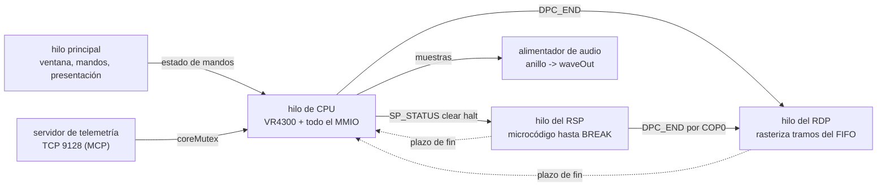

# kestrel64 — Arquitectura

Synced with: 30d291b

Este es el mapa general del emulador: qué hace cada parte, cómo se hablan las partes y qué
invariantes las mantienen unidas. Está un nivel por encima de los documentos de diseño; cada
sección termina con los documentos que conviene leer para profundizar. La versión inglesa,
`docs/ARCHITECTURE.md`, tiene las mismas secciones en el mismo orden. Los dos ficheros se
actualizan en el mismo commit, y `scripts/check_docs_sync.py` falla si su estructura o su línea
`Synced with:` se desalinean.

Las cifras vigentes y el estado por subsistema están en `docs/STATUS.md`; los huecos abiertos, en
`docs/GAPS.md`.

## 1. Visión general

kestrel64 es un emulador de Nintendo 64 de bajo nivel (LLE) escrito desde cero en C++20 (clang,
Windows, enlazado estático). No hay emulación de alto nivel: no se intercepta ninguna función de
libultra, y el RSP ejecuta el microcódigo instrucción a instrucción. Todo pasa por los registros
MMIO reales (`SP_*`, `DPC_*`, `VI_*`, `AI_*`, `SI_*`, `PI_*`, `MI_*`) y por las interrupciones MI.

La apuesta de arquitectura son **hilos reales del sistema operativo** para la CPU, el RSP y el
RDP, en lugar de la planificación cooperativa en un solo hilo (cothreads) que usan los
emuladores exactos al ciclo. El objetivo es un anfitrión con poco rendimiento por hilo y núcleos
o GPU ociosos, donde un diseño cooperativo choca con el techo de un núcleo.

Hilos del proceso:

Los hilos del RSP y del RDP solo existen en modo Threaded; en modo Lockstep el hilo de CPU hace
los tres trabajos (sección 2). El determinismo es un requisito de diseño, no una casualidad:
Lockstep es determinista por construcción, y Threaded tiene que dar el mismo estado final
(statehash) cuando los atajos del anfitrión están apagados.

Profundidad: `docs/ARCH-COMM.md` (modelo de ejecución, escrito para revisión externa),
`docs/ARCH-THREADING.md`, `docs/STATUS.md`.

## 2. Modelo de tiempo

Todo el tiempo del invitado se cuenta en **instrucciones de invitado retiradas** («ops»); no hay
un contador maestro de ciclos aparte. Un modelo de CPI (1,4 de fábrica, `KESTREL_CPI`) convierte
ops en ciclos de CPU, y `rcpOpsToCycles` / `rcpCyclesToOps` convierten al reloj de 62,5 MHz del
RCP. El reloj que leen todos los componentes es `Memory::cartNow()`: ops retiradas, más las ops
de la cadena del JIT en curso, más las paradas de caché cuando el modelo de coste físico está
encendido. La duración del campo de vídeo, las interrupciones del VI y `VI_V_CURRENT` salen del
mismo reloj (`docs/VI-CLOCK.md`).

La planificación tiene dos mecanismos:

- **Plazos en el reloj del invitado**, que el hilo de CPU comprueba tras cada instrucción y tras
  cada bloque del JIT: fin de VI, AI, SI y PI, y fin del trabajo del RSP y del RDP. Un DMA tiene
  duración; su efecto y su interrupción ocurren al vencer el plazo. El JIT no puede tragarse un
  plazo dentro de un bloque (`rcpDueIn`).
- **Citas entre hilos** en modo Threaded. El RSP y el RDP no se planifican por tiempo: se
  acoplan al reloj de la CPU en los puntos donde el hardware obliga a que uno vea lo que hizo el
  otro (barrera del SP, sincronías de lectura, barreras de escritura, diarios, aparcamiento del
  RSP en las esperas del FIFO).

La regla dura: **solo el hilo de CPU cambia el estado visible del invitado en un instante.** Los
workers calculan y proponen (arman plazos fechados en tiempo de invitado); el hilo de CPU publica
cuando su reloj llega a ese instante. Los datos que cruzan hilos van por atómicos con
release/acquire o bajo los mutex `rspMx`/`rdpMx`.

Los dos modos:

| | Lockstep | Threaded (`KESTREL_THREADS`, de fábrica) |
|---|---|---|
| RSP | intercalado dentro del bucle de CPU, 4/3 ops de RSP por op de CPU | hilo propio, acoplado por citas |
| RDP | síncrono dentro del store a `DPC_END` | cola SPSC + worker |
| Uso | referencia determinista, systemtest | jugar y medir |

Dos atajos del anfitrión dejan que la CPU se adelante al RSP para ganar velocidad:
`KESTREL_SPLEAD` (auto = 512) y `KESTREL_DPLOGLEAD`. Están encendidos al jugar en velocidad
libre, y valen 0 en el modo «fiel a consola» (`KESTREL_SPEEDMODE=hw`) y en todas las puertas. Con
los dos a 0, Threaded da el mismo statehash que Lockstep; esa igualdad es el invariante que
comprueban las puertas.

Profundidad: `docs/ARCH-COMM.md` (secciones 2-3, 6-8), `docs/ARCH-SYNC.md`,
`docs/HW-RCP-COMM.md`, `docs/PERF-RCP-SYNC.md`, `docs/history/SUBSCHED-2026-09.md`
(planificación del RDP al enviar y aparcamiento del RSP).

## 3. Memoria y bus

La clase `Memory` (`src/core/memory.hpp`) es la dueña de la RDRAM (8 MB, o 4 MB con `KESTREL_RDRAM=4`), de todos los
registros MMIO, de los motores de DMA y de las citas entre hilos. El hilo de CPU es el dueño de
todo el MMIO; el único otro hilo que escribe registros del RCP es el RSP, a través de su COP0.

- **DMA**: PI (cartucho, con coste de traslado y decaimiento del latch de E/S), SI (PIF/joybus,
  que corre dentro del DMA de lectura PIF->RDRAM, como en el hardware), SP (DMEM/IMEM contra
  RDRAM) y AI. Los traslados de SI y PI tienen duración y terminan en un plazo.
- **Cachés y TLB** viven en la CPU (sección 4): las cachés I y D se modelan con tags y líneas
  sucias, y una escritura de la CPU solo la ve el RSP cuando llega de verdad a la RDRAM (vuelco
  de línea sucia o store sin caché), que es donde está `cpuRamWrBarrier`.
- **MI**: `mi_intr` es un atómico; los productores publican con release tras sus escrituras a
  RDRAM y la CPU adquiere al leer.
- **PIF, partidas y hardware del cartucho**: arranque del PIF con la suma IPL2 real y el CIC
  detectado por firma; EEPROM, SRAM, FlashRAM; cuatro mandos con Rumble, Controller y Transfer
  Pak; SummerCart64 con tarjeta SD como FAT32 virtual.

Su implementación está partida por responsabilidad (mapa en `src/core/memory_internal.hpp`):
`memory.cpp` (reset, mapa de direcciones, lecturas/escrituras de la CPU, bus PI),
`memory_cart.cpp` (partidas, paks, SummerCart64), `memory_mmio.cpp` (registros, ticks de VI/AI),
`memory_dma.cpp` (DMA de PI/SP/SI), `memory_pif.cpp` (PIF, CIC, RTC, joybus), `rcp_rdp.cpp`
(trabajos y worker del RDP) y `rcp_sync.cpp` (regulador, barreras de invitado, citas, worker
del RSP).

Profundidad: `docs/ARCH-COMM.md` (sección 4), `docs/FLASHCART-SD.md`,
`docs/ROMS-COMPRIMIDAS.md`.

## 4. CPU

- **Intérprete** (`src/cpu/cpu*.cpp`): MIPS III de 64 bits con delay slots, COP0 completo, FPU con
  redondeo y banderas, TLB de 32 entradas con sus excepciones, cachés I y D modeladas con tags, y
  la excepción Watch. Es la referencia: el dynarec llama a sus helpers en los casos difíciles.
- **Dynarec** (`src/cpu/jit*.cpp`: caché de código y enlace en `jit.cpp`, emisores y
  `compileBlock` en `jit_compile.cpp`, despacho del lado de la CPU en `jit_run.cpp`; activo de fábrica, `KESTREL_JIT=0` lo apaga): bloques de línea
  recta compilados a x86-64 desde una dirección física, con residencia de registros en los
  registros no volátiles de Win64, memoria rápida con guardas, enlace estático de bloques, caché
  de destinos indirectos para `JR`/`JALR`, bloques que cruzan página, COP0 dentro del bloque y
  detección de código automodificable por línea de I-caché. Lo que no emite en nativo (casi toda
  la FPU, cargas y stores desalineados, multiplicación/división de 64 bits) llama al intérprete
  sin cortar el bloque. El «nivel 2» del plan del dynarec se cerró el 2026-10-01.
- **Modelo de ciclos**: CPI plano de 1,4 de fábrica; un modelo físico opcional (modos `phys` de
  las puertas) añade el coste de los fallos de I/D-caché, el acceso sin caché, la latencia de
  MULT/DIV y FPU y los enclavamientos.
- **PGO**: el build de distribución usa un perfil commiteado (`pgo/kestrel.profdata`). Solo
  cambia la colocación del código del anfitrión; el statehash del invitado es idéntico con y sin
  él.

Profundidad: `docs/CORES-CPU-RSP.md` (secciones 2-3), `docs/PERF-CPU.md`, `docs/JIT-PLAN.md`
(plan original, en parte histórico).

## 5. RSP

- **Intérprete** (`src/rsp/rsp.cpp`): núcleo escalar más la unidad vectorial (8 carriles de 16
  bits, acumulador de 48 bits, banderas y saturación) implementada con SSE4.1.
- **RSP JIT** (`src/rsp/rspjit.cpp`, activo de fábrica, `KESTREL_RSPJIT=0` lo apaga): bloques de
  línea recta, saltos absorbidos, COP0 dentro del bloque y enlace por una tabla directa de 1024
  ranuras; partes de COP2 se emiten en línea. El md5 del framebuffer es el mismo con el JIT
  encendido y apagado en todos los modos de las puertas.
- **Modelo de tiempos del pipeline** (`KESTREL_RSP_TIMING=1`, `src/rsp/rsptiming.hpp`): cuenta
  paradas y emisión doble por ranura de IMEM para perfilar. Fuerza el intérprete y no mueve el
  reloj del invitado.
- El arranque de una tarea lo fecha el hilo de CPU en la escritura de clear halt a `SP_STATUS`;
  el fin de tarea es un plazo que publica el hilo de CPU (`BROKE` + `MI_SP`).

No hay HLE de microcódigo gráfico, por diseño.

Profundidad: `docs/CORES-CPU-RSP.md` (secciones 4-5), `docs/RSP-JIT.md`.

## 6. RDP

Una escritura a `DPC_END` (de la CPU o del RSP) archiva un tramo del FIFO; el hilo del RDP lo
rasteriza. La línea de tiempo del tramo en el invitado (inicio, fin, fronteras de `DPC_CURRENT`,
plazo de `MI_DP`) se calcula al enviar con el modelo de coste del RDP, así que el worker solo
pinta. Las lecturas de `DPC_CURRENT` y `DPC_STATUS` se contestan en el reloj de quien lee.

Tres rasterizadores comparten esa entrada:

- **SoftRDP** (`src/rdp/rdp.cpp`): la referencia bit a bit, en la CPU. LOD y mipmaps, corrección
  de perspectiva, interpolación entera, delta-z, intercambio de filas impares en TMEM y
  antialiasing por cobertura. Es lo que corre `gate_all.sh`, así que el oráculo determinista
  nunca depende de una GPU.
- **GPU-RDP** (`src/gpurdp/`, Vulkan compute, de fábrica desde 2026-10-06): bit a bit igual que
  SoftRDP a resolución nativa. El reparto CPU/GPU por tramo es por tamaño
  (`KESTREL_GPURDP_MINPX`). El escalado interno x2, x4 y x8 va en **modo sombra**: SoftRDP pinta
  a 1x y sigue siendo la autoridad sobre la RDRAM, mientras la GPU produce la copia de alta
  resolución de forma asíncrona; las escrituras que llegan a las imágenes por otros caminos se
  detectan comparando el espejo y se parchean.
- **parallel-RDP** (`src/vrdp/`, `third_party/`): en retirada. Fuera de menús y puertas desde el
  2026-10-30; solo se llega a mano con `KESTREL_PRDP=1`; el código se va en la próxima versión.

Los paquetes de texturas HD (formato Rice/GLideN64) funcionan en SoftRDP y GPU-RDP
(`src/rdp/texpack.cpp`).

Profundidad: `docs/GPU-RDP.md`, `docs/RDP-TIMING.md`, `docs/RDP-COVERAGE-AA.md`,
`docs/RDP-FIFO-BACKPRESSURE.md`, `docs/TEXTURE-FORMATS.md`, `docs/TEXTURAS-HD.md`,
`docs/FIDELITY.md`.

## 7. VI, presentación y audio

- **VI**: no tiene framebuffer propio; relee la RDRAM en cada campo. Las interrupciones saltan en
  los cruces de media línea de `VI_INTR`, con el mismo reloj que `VI_V_CURRENT`.
- **Presentación** (`src/video/present.cpp`): ventana GLFW con Vulkan, o GDI cuando no hay Vulkan.
  El filtro del VI (antialias, dedither, divot) se aplica en el presentador (`vifilter.cpp`),
  seguido de los filtros de imagen opcionales (`postfx.cpp`, `KESTREL_FILTER`), la relación de
  aspecto y el SSAA. Capturas de pantalla y de vídeo en tiempo de invitado (`capture.cpp`).
- **Audio** (`src/audio/audio.cpp`): el DAC del AI drena por muestras, en aritmética entera, sobre
  el reloj del invitado y con el reloj de muestreo de la norma de TV (NTSC, PAL, MPAL). Un hilo
  alimentador del anfitrión solo consume un anillo hacia waveOut; nunca toca el tiempo del
  invitado.

Profundidad: `docs/VI-CLOCK.md`, `docs/FILTROS-IMAGEN.md`, `docs/ESCALADO-Y-ASPECTO.md`.

## 8. Estado: savestates, rebobinado y TAS

- **Savestates** (`src/core/savestate.cpp`, formato v22, carga v14-v21): solo se toman en un
  reposo natural del RCP (`System::quiesceRcp`: motor drenado, tarea terminada), así que las
  agendas derivadas no se serializan; se reinician al cargar.
- **Rebobinado** (`src/core/rewind.cpp`): guarda fotos periódicas; apagado de fábrica.
- **TAS**: películas de entradas en formato `.k64m` (`src/core/movie.hpp`), grabadas y
  reproducidas por lectura de mandos, con avance de campo desde la ventana o el MCP.

Profundidad: `docs/SAVESTATES.md`, `docs/REWIND.md`, `docs/TAS.md`.

## 9. Telemetría, MCP y depurador

- **Servidor de telemetría** (`src/telemetry/server.cpp`) en el puerto TCP 9128: JSON con marco
  de longitud más cargas binarias en crudo (los volcados de RAM y los framebuffers viajan como
  bytes). Toma `coreMutex` para actuar sobre el núcleo. El puente MCP `tools/mcp/kestrel_mcp.py`
  lo expone a los agentes: control de ejecución, memoria, registros, desensamblado, puntos de
  ruptura, inyección de mando, captura del framebuffer, perfiladores, símbolos del invitado y
  juego en red.
- **Depurador** (`src/debug/dbg.cpp`, `src/telemetry/server_dbg.cpp`, ventana ImGui con
  `--debugger`): grabadora de cuadro RDP/RSP, línea de tiempo, visores de TMEM y TLB, registro de
  eventos, vigilancia de memoria, registro USB del SummerCart64, recarga en caliente de código,
  microcódigo del RSP y ROM, y puntos de ruptura del RSP. La ventana habla con el mismo servidor
  que el MCP.
- **Perfilador del anfitrión** (`src/telemetry/hostprof.cpp`): muestrea los hilos del anfitrión
  para ver adónde va el tiempo de pared.

Profundidad: `docs/MCP-GUIA.md`, `docs/DEBUGGER.md`, `docs/ENV-VARS.md`.

## 10. Build, empaquetado y verificación

- Cadena de herramientas: clang de MSYS2 CLANG64, CMake + Ninja. Todos los árboles enlazan
  estático; solo se importa `vulkan-1.dll` del sistema, y `cmake/check_static.cmake` rompe el
  build si no es así.
- `sh scripts/release.sh` recompila los cuatro árboles, el lanzador congelado, el zip portable y
  el instalador, y escribe `dist/VERSION.txt`. El paquete lleva un solo `kestrel64.exe` con
  GPU-RDP y SoftRDP.

La verificación es por oráculos, no a ojo:

| Puerta | Qué cubre |
|---|---|
| `scripts/validate.py systemtest` | n64-systemtest: 0/3721 fallos, Timing 0/2, Cycle 0/6 |
| `scripts/validate.py sm64` | md5 del framebuffer tras N intercambios de búfer, igual en todos los modos |
| `scripts/validate.py krom` | 371 ROMs de exactitud del RDP contra una baseline |
| `scripts/gate_all.sh` | todo lo anterior en cada modo de CPU/RSP sobre SoftRDP, más los tests unitarios |
| `scripts/gate_gpurdp.sh` | el mismo material sobre GPU-RDP |
| `scripts/gate_quick.sh` | subconjunto rápido por cambio (~1,5 min) |
| statehash, Threaded frente a Lockstep | determinismo con `SPLEAD=0` y `DPLOGLEAD=0` |
| `test/*.cpp` | tests unitarios que no necesitan ROM (también corren en CI) |

La velocidad se mide con `scripts/validate.py bench` (tiempo de pared para un número fijo de
campos VI del invitado), nunca con MIPS: en modo Threaded un hilo de CPU más rápido puede quemar
más instrucciones de espera activa mientras el emulador va más lento. Las puertas necesitan ROMs
que no están en el repositorio; la CI (`.github/workflows/build.yml`) comprueba que el árbol
compila y corre los tests unitarios.

Profundidad: `docs/distribucion.md`, `CONTRIBUTING.md`, `docs/baselines/`.

## 11. Mapa de `src/`

| Directorio | Responsabilidad | Ficheros de entrada |
|---|---|---|
| `src/main.cpp` | línea de órdenes, arranque | `main.cpp` |
| `src/core/` | bucle y relojes, memoria/MMIO/DMA/citas, carga de ROM, partidas, savestates, rebobinado, trucos, archivos comprimidos, extras del cartucho | `system.cpp`, `memory.cpp` (+ `memory_*.cpp`, `rcp_*.cpp`), `rom.cpp`, `savestate.cpp`, `rewind.cpp` |
| `src/cpu/` | intérprete del VR4300 y dynarec x86-64 | `cpu.cpp` (+ `cpu_boot.cpp`, `cpu_fpu.cpp`, `cpu_disasm.cpp`), `jit.cpp` (+ `jit_compile.cpp`, `jit_run.cpp`) |
| `src/rsp/` | intérprete del RSP, RSP JIT, modelo de tiempos del pipeline | `rsp.cpp`, `rspjit.cpp`, `rsptiming.hpp` |
| `src/rdp/` | SoftRDP (rasterizador de referencia), paquetes de texturas HD | `rdp.cpp` (+ `rdp_cmd.cpp`), `texpack.cpp` |
| `src/gpurdp/` | GPU-RDP, rasterizador Vulkan compute y shaders | `gpurdp.cpp`, `shaders/` |
| `src/vrdp/` | pegamento de parallel-RDP y contexto Vulkan compartido (en retirada) | `vrdp.cpp` |
| `src/video/` | presentador, filtro del VI, filtros de imagen, captura | `present.cpp`, `vifilter.cpp`, `postfx.cpp`, `capture.cpp`, `fbdump.cpp` |
| `src/audio/` | salida del AI al anfitrión | `audio.cpp` |
| `src/telemetry/` | servidor de telemetría/MCP, puntos del depurador, símbolos, perfilador del anfitrión | `server.cpp`, `server_dbg.cpp`, `symbols.cpp`, `hostprof.cpp` |
| `src/debug/` | núcleo del depurador (grabadoras, vigilancias) | `dbg.cpp` |
| `src/ui/` | menú Win32, biblioteca de juegos, ficha de juego, opciones, ventana del depurador | `menu_win32.cpp`, `library_win32.cpp`, `gamecard.cpp`, `optdefs.cpp`, `debugger_win32.cpp` |
| `src/net/` | juego en red (lockstep de entradas), relé, UPnP, TCP | `netplay.cpp`, `relay.cpp`, `upnp.cpp`, `tcp.cpp` |
| `test/` | tests unitarios sin ROMs | `*_test.cpp` |
| `tools/` | puente MCP, lanzador, generadores de shaders y opciones | `mcp/kestrel_mcp.py`, `launcher/` |
| `scripts/` | build, distribución, puertas, bancos de medida, mantenimiento | `release.sh`, `validate.py`, `gate_all.sh` |
